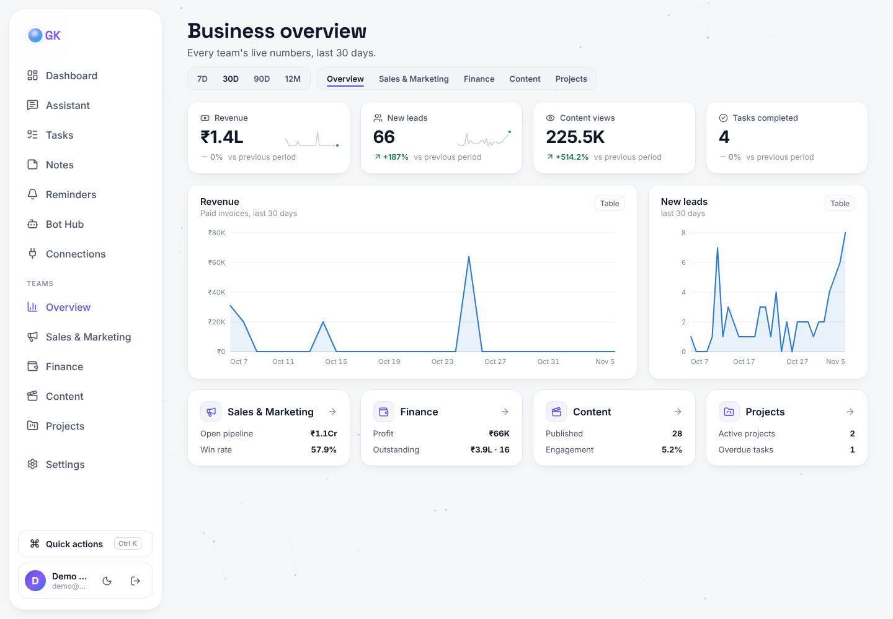
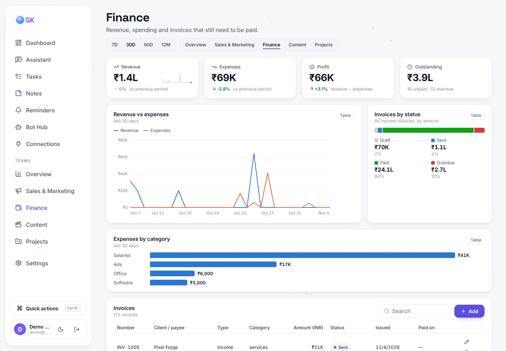
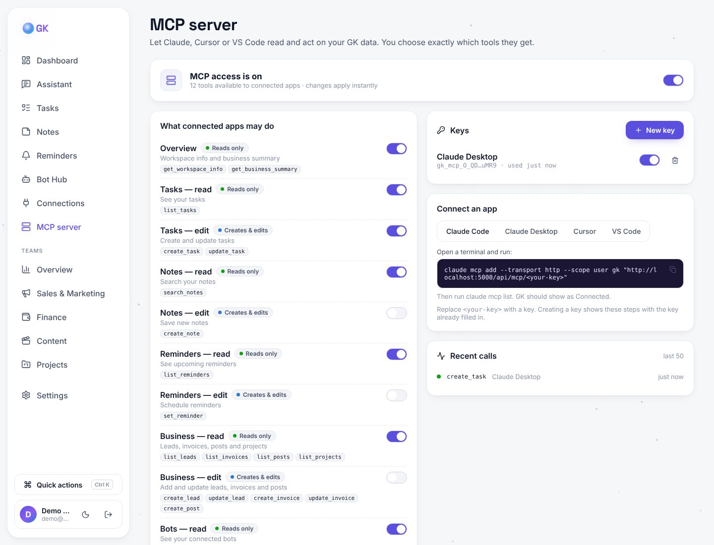
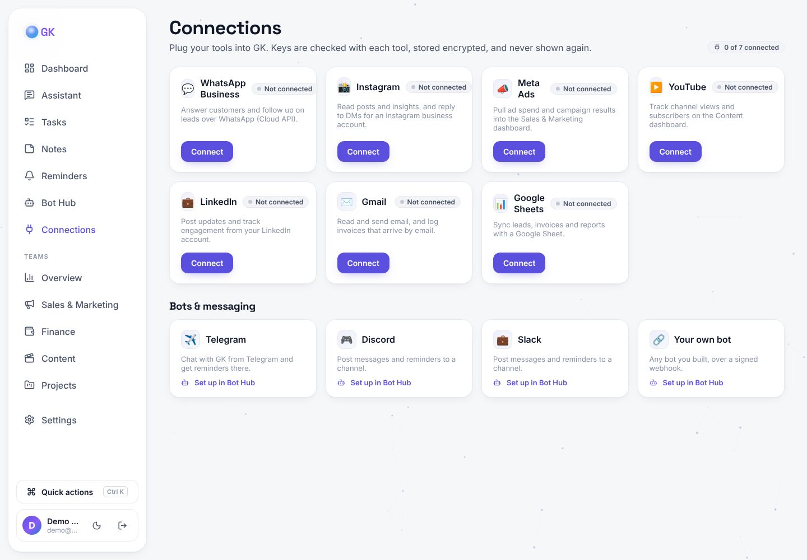
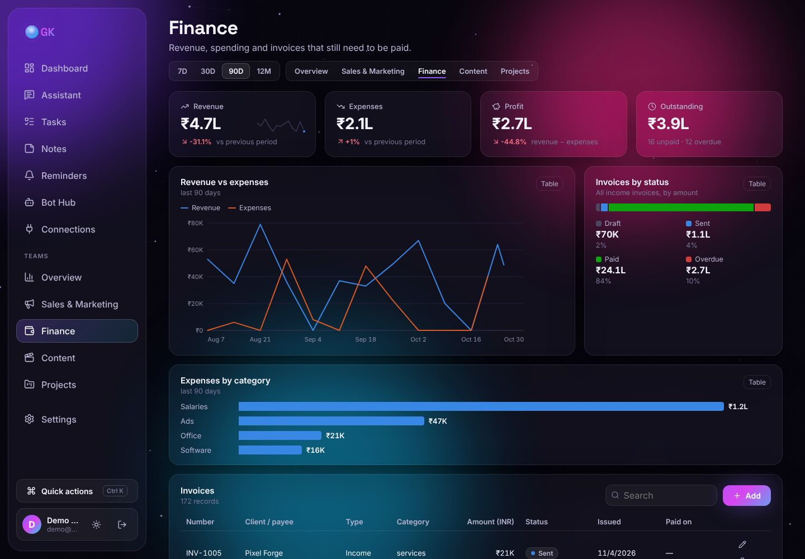

# ✨ GK — Personal Assistant (end to end)

GK is a full-stack personal assistant and business dashboard. It manages your **tasks, notes and reminders**, gives each team (**Sales & Marketing, Finance, Content, Projects**) its own live analytics dashboard, and acts as a **hub for all your bots and tools**: create bots, connect bots you already have (Telegram, Discord, Slack, or any webhook bot you've built), and plug in WhatsApp, Gmail, Google Sheets, Instagram, YouTube, LinkedIn and Meta Ads.

| Layer | Tech |
| --- | --- |
| 🎨 Frontend | **React 19** + Vite, **Framer Motion** animations, clean white theme (dark glass optional), hand-built SVG charts, Lucide icons, Socket.IO client, Web Speech API (voice) |
| ⚙️ Backend | **Node.js** + Express 5, Socket.IO (real-time), JWT auth, node-cron scheduler |
| 🍃 Database | **MongoDB** + Mongoose |
| 🐍 AI service | **Python** + FastAPI: sentiment, intent (Naive Bayes), entities, keywords, summaries |
| 🧠 LLM brain (optional) | **Any AI provider** with tool use: Claude (`claude-opus-5-5` by default), OpenAI, Google Gemini, Groq, OpenRouter, Mistral, DeepSeek, xAI, Together, Ollama, or any OpenAI-compatible API. Without a key, a built-in rule-based brain is used |



---

## Contents

- [Features](#-features)
- [Screenshots](#-screenshots)
- [Architecture](#-architecture)
- [Quick start](#-quick-start)
- [Using the assistant](#-using-the-assistant)
- [Bots: create and connect](#-bots-create-and-connect)
- [MCP server: connect Claude to GK](#-mcp-server-connect-claude-to-gk)
- [API reference](#-api-reference)
- [Project structure](#-project-structure)
- [Configuration](#-configuration)
- [Testing](#-testing)
- [Deploying](#-deploying)
- [Production readiness (10,000 users)](#-production-readiness-10000-users)

---

## 🚀 Features

**Assistant**
- Chat in natural language. The assistant takes real actions: creates tasks, saves notes, schedules reminders, and calls bots.
- **AI brain, any provider** (once you add a key in **Settings → AI brain**, or set `ANTHROPIC_API_KEY` / `AI_API_KEY` on the server): an agentic tool-use loop with 10 tools (`create_task`, `set_reminder`, `call_bot`, `analyze_text`, …).
- **Rule-based brain** (no key needed): understands the core commands, so the app works offline.
- **Voice**: speak to it (speech-to-text) and have it read replies aloud (text-to-speech).
- Real-time replies over Socket.IO. Conversations sync across tabs and channels.

**Productivity**
- 📋 Kanban tasks with drag & drop, priorities and due dates
- 📝 Masonry notes with colors and pins. Long notes get an auto-summary from Python
- ⏰ Reminders (once, daily or weekly), delivered as in-app toasts, browser notifications and voice, **and through your Telegram / Discord / Slack bots**
- 📊 Animated dashboard: stats, 7-day activity chart, progress ring, bot fleet, service health

**Team dashboards** (Admin Dashboard V2)
- **Overview** of every team plus a page each for **Sales & Marketing**, **Finance**, **Content** and **Projects**
- KPI tiles with change vs the previous period and sparklines; one date-range filter (7D / 30D / 90D / 12M) scopes every number on the page
- Charts: revenue vs expenses, leads over time, pipeline funnel, leads by source, views by platform, invoice and content status, project progress meters. Every chart has a hover tooltip and a **Table** view
- Each team page has its own records table (leads, invoices, posts, projects) with search, add, edit and delete; tasks can be linked to projects
- **Load sample data** with one click to see the dashboards before you add real records. Currency is set in Settings (default INR)

**Connections**
- One page to plug in **WhatsApp Business, Instagram, Meta Ads, YouTube, LinkedIn, Gmail and Google Sheets**
- Each card asks for that tool's keys, shows step-by-step help, makes one read-only call to check them, and stores them encrypted
- Telegram, Discord, Slack and your own bots connect through the Bot Hub
- These connections store and verify access. The automations that use them (replying to DMs, following up leads, syncing sheets) are the next step

**MCP server**
- GK is an **MCP server**, so Claude Code, Claude Desktop, Cursor and VS Code can read and act on your GK data
- 23 tools in 12 groups (tasks, notes, reminders, leads, invoices, posts, projects, bots…). Only read groups start on; edit, send and delete groups are separate switches that start off
- **MCP server** page: master switch, a switch per group, keys (hashed, shown once, can be switched off or deleted), copy-paste setup for each app, and a live log of every call

**Bot Hub** (the integration layer)
- **Create** bots with a 3-step animated wizard: built-in skills, AI personas, webhooks, Telegram, Discord, Slack
- **Route** messages to a bot with `@handle` mentions (with autocomplete) or trigger words
- **Connect** any external bot *into* the assistant through the signed **inbound API**
- Test console, activity logs, per-bot stats, enable/disable, API key rotation

**UI / animation**
- Aurora gradient blobs and an interactive particle constellation background
- An animated assistant "orb" with idle, thinking, listening and speaking states
- Shared-layout nav pill, page transitions, staggered cards, spring modals, animated counters and charts
- Command palette (**Ctrl/⌘ + K**): jump anywhere or send a command straight to the assistant
- A clean white theme by default with the dark aurora-glass theme one click away, a responsive mobile layout with a bottom nav, and `prefers-reduced-motion` support

---

## 📸 Screenshots

| Sales & Marketing | Finance |
| --- | --- |
|  |  |
| **MCP server** | **Connections** |
|  |  |
| **Finance (dark theme)** | |
|  | |
| **Assistant chat** | **Bot Hub** |
|  |  |
| **Bot creation wizard** | **Light theme + live reminder** |
|  |  |
| **Login** | **Mobile** |
|  |  |

---

## 🏗 Architecture

```
                 ┌───────────────────────────────┐
                 │  React client (Vite, :5173)   │
                 │  Framer Motion · Socket.IO    │
                 └──────────────┬────────────────┘
                     REST /api  │  WebSocket
                 ┌──────────────▼────────────────┐        ┌──────────────────────┐
  Telegram  ───▶ │   Node.js API (Express, :5000)│ ─────▶ │ Python AI (FastAPI,  │
  Inbound API ─▶ │                               │        │ :8000) sentiment,    │
  (your bots)    │  assistant.handleMessage()    │        │ intent, summaries    │
                 │   ├─ @mention / trigger ──▶ botManager ──▶ builtin · AI · webhook
                 │   │                         │           telegram · discord · slack
                 │   └─ brain: Claude tools  or  rule-based
                 │  scheduler (reminders) ─▶ socket + notify bots
                 └──────────────┬────────────────┘
                                │ Mongoose
                        ┌───────▼────────┐
                        │    MongoDB     │  users · conversations · messages
                        └────────────────┘  tasks · notes · reminders · bots · botlogs
```

**One entry point for every channel.** Whether a message comes from the web UI, Socket.IO, Telegram, or another bot through the inbound API, it goes through `server/src/services/assistant.js → handleMessage()`:

1. Save the user message (with sentiment from Python, if the service is running).
2. If the message `@mentions` a bot or contains one of its trigger words, **dispatch it to that bot**.
3. Otherwise the **brain** handles it: Claude with tools, or the rule-based fallback. Tools can call bots too (`call_bot`), so the assistant can orchestrate your whole fleet.
4. Save the reply and push it live to every open tab.

---

## ⚡ Quick start

> **Going live on your own domain (e.g. g5tech.in) with HTTPS?** Follow [docs/DEPLOY.md](docs/DEPLOY.md).

### Option A: Docker (everything in one command)

```bash
docker compose up --build
# open http://localhost:8080   →  demo login: demo@assistant.dev / demo1234
```

**Turn on the AI brain (any provider):** sign in, open **Settings → AI brain**, paste a key and click **Connect**. GK recognises the provider from the key (`sk-ant-` Claude, `sk-` OpenAI, `AIza` Gemini, `gsk_` Groq, `sk-or-` OpenRouter, `xai-` xAI) or you pick it from the list (Mistral, DeepSeek, Together, Ollama, or **Other** for any OpenAI-compatible API with its base URL). Leave **Model** blank for a good default. GK checks the key with the provider, stores it encrypted in MongoDB, and starts using it immediately. No restart needed. Each user can use a different provider.

For **Ollama** on your own computer: pick *Ollama*, leave the key empty, and GK reaches it at `http://host.docker.internal:11434/v1`. In production builds, private addresses are blocked unless you set `ALLOW_PRIVATE_WEBHOOKS=true`.

Prefer one key for everyone? Copy `.env.example` to `.env` (next to `docker-compose.yml`), fill in `ANTHROPIC_API_KEY=` (Claude) or `AI_API_KEY=` (any other provider, plus optional `AI_PROVIDER`, `AI_MODEL`, `AI_BASE_URL`), then run `docker compose down` and `docker compose up`. A user's own key takes priority over the server key. (On Windows, `ANTHROPIC_API_KEY=... docker compose up` doesn't work in PowerShell, so use the `.env` file.)

### Option B: Run locally

Requirements: **Node 20+**, **Python 3.10+**, and **MongoDB** (local, Atlas, or `docker run -p 27017:27017 mongo:7`).

```bash
# 1. Install everything
npm install                 # root helper (concurrently)
npm run install:all         # server + client + python deps

# 2. Configure the API
cp server/.env.example server/.env
#    edit MONGO_URI / JWT_SECRET, optionally ANTHROPIC_API_KEY
#    no MongoDB? set USE_MEMORY_DB=true for a throwaway in-memory DB

# 3. Create the demo account (optional)
npm run seed                # demo@assistant.dev / demo1234

# 4. Start API + web + Python service together
npm run dev
```

Open **http://localhost:5173**.

| Service | URL |
| --- | --- |
| Web app | http://localhost:5173 |
| API | http://localhost:5000/api/health |
| Python AI docs (Swagger) | http://localhost:8000/docs |

> The Python service and Claude are both **optional**. The assistant degrades gracefully, and the dashboard shows which services are online.

---

## 💬 Using the assistant

Try these in the chat (they work with the rule-based brain; with Claude, any phrasing works):

| Say | What happens |
| --- | --- |
| `help` | Lists capabilities |
| `add task prepare slides urgent` | Creates a high-priority task |
| `show my tasks` / `complete prepare slides` | Lists / completes tasks |
| `note: wifi — password is blue-42` | Saves a note |
| `search notes wifi` | Searches notes |
| `remind me to call mom in 20 minutes` | Schedules a reminder (`at 5pm`, `tomorrow at 9:30`, `tonight` also work) |
| `@weather in Tokyo` | Live weather bot |
| `@calc (24 * 7) / 3` | Safe calculator bot |
| `@wiki Alan Turing` | Wikipedia bot |
| `tell me a joke` | Routed to the Jester bot by its trigger word |
| `analyze: I love it but it's slow` | Python NLP: sentiment, keywords, intent |
| `list bots` | Shows your bot fleet |

Press **Ctrl/⌘ + K** anywhere to run a command without opening the chat. Click the 🎙️ mic to talk.

> **Mic not working?** Voice input uses the browser's speech recognition: use **Chrome or Edge** (Firefox doesn't support it and Brave blocks it), open the app at **http://localhost** or an https address (not an IP like `192.168.x.x`), allow the microphone when asked, and stay online (Chrome sends audio to Google to recognise it). If something is wrong, GK now tells you exactly what.

---

## 🤖 Bots: create and connect

Every new account starts with 5 bots: **Weather, Calculator, Wikipedia, Jester, Coach**. Open **Bot Hub → Create bot** to add more:

| Type | What it does | You provide |
| --- | --- | --- |
| 🧩 **Built-in skill** | Runs inside the assistant | Pick a skill: calculator, weather, wikipedia, joke, echo |
| 🧠 **AI persona** | A Claude-powered character with its own instructions | A system prompt ("You are Chef…") |
| 🔗 **Webhook (your own bot)** | We POST each message to your server; you reply with JSON | Your endpoint URL |
| ✈️ **Telegram** | Chat with your assistant **from Telegram** and get reminders there | A token from @BotFather |
| 🎮 **Discord** | Post messages and reminders to a channel | An incoming webhook URL |
| 💼 **Slack** | Post messages and reminders to a channel | An incoming webhook URL |

Each bot gets an **API key** and an **inbound endpoint**, so traffic works in both directions:

- **Assistant → your bot**: `@yourbot hello` triggers a signed `POST` to your webhook.
- **Your bot → assistant**: your bot calls `POST /api/integrations/inbound/:botId` with `X-Bot-Key`, and the assistant answers as if you typed it.

```bash
curl -X POST http://localhost:5000/api/integrations/inbound/<BOT_ID> \
  -H "Content-Type: application/json" \
  -H "X-Bot-Key: <BOT_API_KEY>" \
  -d '{"text":"remind me to stretch in 10 minutes","sessionId":"my-bot-chat-1"}'
# → {"reply":"⏰ I'll remind you to stretch on …","conversationId":"…"}
```

📘 Full guide with payload formats, signature verification, and Telegram setup: **[docs/BOT_INTEGRATION.md](docs/BOT_INTEGRATION.md)**.
Ready-to-run examples are in [`examples/`](examples/): a Node webhook bot, a Python webhook bot, and a Python script that talks to the assistant.

---

## 🔌 MCP server: connect Claude to GK

1. Open **MCP server** in the sidebar and turn **MCP access** on.
2. Choose what apps may do. Read groups are on; switch on **Tasks — edit**, **Business — edit**, **Send through bots** or **Delete** only when you want them. Changes apply instantly, even to apps that are already connected.
3. Click **New key**, name it after the app, and copy the URL. **The URL is a password** and is shown only once.
4. Connect your app (the page shows these with your key filled in):

The connection URL looks like `http://localhost:8080/api/mcp/gk_mcp_…` with Docker, or `http://localhost:5000/api/mcp/gk_mcp_…` with `npm run dev`. The MCP page always shows the right one.

| App | How |
| --- | --- |
| Claude Code | `claude mcp add --transport http --scope user gk "<connection URL>"`, then `claude mcp list` |
| Claude Desktop (GK on localhost) | Settings → Developer → Edit Config, add `"gk": { "command": "npx", "args": ["-y", "mcp-remote", "<url>"] }` under `mcpServers`, then restart Claude Desktop |
| Claude Desktop or web (GK deployed on https) | Settings → Connectors → Add custom connector → paste the URL, leave the OAuth fields empty |
| Cursor | `~/.cursor/mcp.json` → `{ "mcpServers": { "gk": { "url": "<url>" } } }` |
| VS Code | `.vscode/mcp.json` → `{ "servers": { "gk": { "type": "http", "url": "<url>" } } }` |

> Claude's **custom connectors** are reached from Anthropic's servers, so they need GK at a public **https** address. While GK runs on your laptop, use Claude Code or the Claude Desktop config above.

Then just ask: *"What's my revenue this month?"*, *"Which invoices are overdue?"*, *"Add a task to call Priya tomorrow"*.

**How it's built** (`server/src/mcp/`): `catalog.js` is the single list of tools, groups and risk tiers. The endpoint (`POST /api/mcp/<key>` or `POST /api/mcp` with `Authorization: Bearer <key>`, Streamable HTTP via the official `@modelcontextprotocol/sdk`) checks the key, reads your switches on every request, and registers only the allowed tools, so a tool that is switched off doesn't exist for the app. Tools reuse GK's own models and actions and only ever see the key owner's data. To add a tool: one entry in `catalog.js` and one definition in `tools.js`; `test/mcp.catalog.test.js` fails if the two drift apart.

Quick check from a terminal:

```bash
curl -s -X POST "http://localhost:5000/api/mcp/<your-key>" \
  -H 'Content-Type: application/json' -H 'Accept: application/json, text/event-stream' \
  -d '{"jsonrpc":"2.0","id":1,"method":"tools/list","params":{}}'
```

---

## 📡 API reference

All routes are prefixed with `/api`. 🔒 means the route needs `Authorization: Bearer <jwt>`.

| Method | Route | Description |
| --- | --- | --- |
| POST | `/auth/register` · `/auth/login` | Returns `{ token, user }` |
| GET/PATCH | `/auth/me` 🔒 | Profile, assistant name, preferences (theme, voice, city) |
| GET | `/auth/ai-providers` 🔒 | The AI providers GK supports |
| PUT/DELETE | `/auth/me/api-key` 🔒 | Save (verified + encrypted) or remove your own AI key: `{ provider?, apiKey, model?, baseUrl? }` |
| POST | `/chat/message` 🔒 | `{ text, conversationId? }` → `{ conversation, messages:[user, reply] }` |
| GET/DELETE | `/chat/conversations[/:id]` 🔒 | List or delete conversations |
| GET | `/chat/conversations/:id/messages` 🔒 | Message history |
| CRUD | `/tasks` · `/notes` · `/reminders` 🔒 | `GET` · `POST` · `PATCH /:id` · `DELETE /:id` |
| GET | `/dashboard` 🔒 | Stats, activity, upcoming reminders, service health |
| GET | `/analytics/:team?days=7\|30\|90\|365` 🔒 | Team analytics: `overview`, `sales`, `finance`, `content`, `projects` |
| POST | `/analytics/sample-data` 🔒 | Add sample leads, invoices, posts and projects (only if you have none) |
| CRUD | `/leads` · `/invoices` · `/posts` · `/projects` 🔒 | Business records behind the team dashboards |
| GET | `/connections` 🔒 | Available tools and your connection status |
| PUT/DELETE | `/connections/:provider` 🔒 | Save + test (secrets encrypted) or remove a tool's credentials |
| POST | `/connections/:provider/test` 🔒 | Re-check saved credentials |
| POST | `/mcp/:key` · `/mcp` (Bearer key) | **MCP endpoint** (JSON-RPC over Streamable HTTP) |
| GET/PUT | `/mcp-admin/settings` 🔒 | MCP master switch and group switches |
| GET/POST/PUT/DELETE | `/mcp-admin/keys[/:id]` 🔒 | MCP keys (the plain key is returned only on create) |
| GET | `/mcp-admin/logs` · `/mcp-admin/connect-info` 🔒 | Recent MCP calls, connection details |
| GET | `/bots` · `/bots/meta` 🔒 | List bots, available types and skills |
| POST/PATCH/DELETE | `/bots[/:id]` 🔒 | Create (returns credentials once), update, delete |
| POST | `/bots/:id/test` 🔒 | Send a message directly to a bot |
| GET | `/bots/:id/logs` · `/bots/:id/credentials` 🔒 | Activity log, API key + inbound URL |
| POST | `/bots/:id/rotate-key` 🔒 | Issue a new API key |
| POST | `/integrations/inbound/:botId` | **External bots → assistant** (header `X-Bot-Key`) |
| POST | `/integrations/telegram/:botId` | Telegram webhook (secret-token verified) |

**Socket.IO** (auth: `{ token }`): emit `chat:send` with `{ text, conversationId }` and an ack. Listen for `message:new`, `assistant:status`, `reminder:due`, `data:changed`, `bot:activity`.

**Python AI service:** `GET /health`, `POST /analyze`, `/intent`, `/sentiment`, `/summarize`. Interactive docs are at `:8000/docs`.

---

## 📁 Project structure

```
.
├── client/                    React app
│   └── src/
│       ├── components/        AnimatedBackground, AssistantOrb, Layout, CommandPalette, ui (Modal, Tabs, Switch…),
│       │                      charts (StatTile, LineChart, BarList, Funnel, SegmentedBar, Meter), admin (TeamShell, RecordsTable)
│       ├── context/           AuthContext (JWT + socket), ToastContext
│       ├── hooks/useVoice.js  Speech recognition + synthesis
│       ├── pages/             Dashboard, Chat, Tasks, Notes, Reminders, Bots, Connections, Settings, AuthPage,
│       │                      admin/ (Overview, Sales, Finance, Content, Projects)
│       └── index.css          Design system (tokens, glass, dark/light)
├── server/                    Node.js API
│   └── src/
│       ├── mcp/               MCP server: catalog, keys, settings, tools, endpoint
│       ├── models/            User, Conversation, Message, Task, Note, Reminder, Bot, BotLog,
│       │                      Lead, Invoice, Post, Project, Integration
│       ├── middleware/        auth (cached sign-in), limits (shared rate limits), idempotency, requestContext, errors
│       ├── routes/            health (live/ready/metrics), auth, chat, bots, integrations, integrations-admin (Connections), analytics, dashboard, crud
│       ├── services/          assistant (orchestrator), llm (Claude), actions (tools), localBrain,
│       │                      scheduler, timeParser, pythonAI, realtime, defaultBots, demoSeed,
│       │                      analytics, sampleData, integrations (tool checks), secrets (encryption)
│       │                      resilience (retry, circuit breaker, leases), cache, aiQuota, urlGuard,
│       │                      rateLimitStore, logger, metrics
│       └── bots/              botManager (routing + dispatch), builtins, calculator,
│                              connectors (Telegram/Discord/Slack), telegramBridge
├── ai-service/                Python FastAPI NLP service (+ pytest tests)
├── examples/                  Sample bots to connect (Node + Python)
├── docs/                      BOT_INTEGRATION.md, PRODUCTION_READINESS.md, RUNBOOK.md, screenshots
├── loadtest/                  k6 load test + quick autocannon benchmark
├── scripts/                   backup.sh, restore.sh (MongoDB)
├── .github/workflows/ci.yml   Tests, build and lint on every push
└── docker-compose.yml         mongo + ai-service + server + client
```

---

## 🔧 Configuration

`server/.env` (see `server/.env.example`):

| Variable | Default | Purpose |
| --- | --- | --- |
| `MONGO_URI` | `mongodb://127.0.0.1:27017/personal_assistant` | MongoDB connection |
| `USE_MEMORY_DB` | `false` | `true` boots an in-memory MongoDB and seeds the demo user |
| `SEED_DEMO` | — | `true` creates the demo account on startup |
| `JWT_SECRET` | dev value | **Must** be set in production |
| `ANTHROPIC_API_KEY` | — | Server-wide Claude key for users who haven't added their own in Settings |
| `AI_API_KEY` | — | Server-wide key for any other provider (takes priority over `ANTHROPIC_API_KEY` when set) |
| `AI_PROVIDER` | guessed from key | `openai`, `gemini`, `groq`, `openrouter`, `mistral`, `deepseek`, `xai`, `together`, `ollama`, `custom` |
| `AI_MODEL` | provider default | Model name, e.g. `gpt-4o-mini`, `llama-3.3-70b-versatile` |
| `AI_BASE_URL` | provider default | API address, required for `custom` (e.g. `https://my-llm.example.com/v1`) |
| `ENCRYPTION_KEY` | `JWT_SECRET` | Encrypts users' saved API keys. Changing it (or `JWT_SECRET` when unset) means users must re-enter their keys |
| `CLAUDE_MODEL` | `claude-opus-5-5` | Claude model id |
| `AI_SERVICE_URL` | `http://localhost:8000` | Python service |
| `CLIENT_URL` | `http://localhost:5173` | CORS origin |
| `PUBLIC_API_URL` | `http://localhost:5000` (Docker: `:8080`) | Public URL of the API. If it's `https://…`, Telegram uses webhooks; otherwise the server long-polls Telegram, which works on localhost |
| `TRUST_PROXY` | — (Docker: `1`) | Number of proxies in front of the API, so client IPs (and IP rate limits) are correct |
| `API_RATE_LIMIT` | `300` | API requests per minute per user (or IP when signed out) |
| `AI_DAILY_LIMIT` | `200` | Claude messages per user per day; `0` = unlimited |
| `MONGO_POOL_SIZE` | `50` | DB connections per API process; keep `copies × pool` below your DB's limit |
| `METRICS_TOKEN` | — | Bearer token for `/api/health/metrics` outside localhost |
| `LOG_FORMAT` / `LOG_LEVEL` | JSON in production | Structured logs with request IDs |
| `ALLOW_PRIVATE_WEBHOOKS` | `false` in production | Allow bot webhooks to private network addresses |

`client/.env`: `VITE_API_URL` (leave it empty in development; Vite proxies `/api`).

---

## 🧪 Testing

```bash
npm test                                                        # server + python tests
cd server && TEST_MONGO_URI=mongodb://127.0.0.1:27017 npm test  # + integration tests on a real MongoDB
cd ai-service && python -m pytest -q
node loadtest/quick-bench.mjs http://localhost:5000             # quick load test (needs autocannon)
k6 run loadtest/k6-load.js                                      # full load test, against staging
```

GitHub Actions (`.github/workflows/ci.yml`) runs the server tests on a real MongoDB, boots the API, lints and builds the client, and runs the Python tests on every push.

---

## 🛡️ Production readiness (10,000 users)

GK was checked against the **TRACEN "10,000 users. Will your app survive?"** guide, section by section. The full report, with before/after load-test numbers, is in **[docs/PRODUCTION_READINESS.md](docs/PRODUCTION_READINESS.md)**, and the outage runbook is in **[docs/RUNBOOK.md](docs/RUNBOOK.md)**.

| | |
|---|---|
| Analytics endpoint | 44 → **844 req/s**, p99 1,574 → **93 ms** |
| One API process (4-core sandbox) | ceiling about **720–740 req/s**; p95 under 500 ms up to ~200 concurrent; **0 errors** in an 800-connection spike |
| Two API copies together | live updates, rate limits, reminders (exactly once) and Telegram failover verified |
| Guide checklist | **21 / 31** verified; the rest need your server and accounts (steps in the report) |

Highlights:
- Rate limits stored in MongoDB, shared across server copies: per user, plus a brute-force login limit.
- Idempotency keys, so a repeated request never runs twice.
- Atomic reminder delivery and a Telegram lease, so nothing is sent twice.
- Circuit breaker, retries with jitter, and timeouts everywhere.
- Per-user caches that clear on every write, plus a per-user daily cap on AI messages.
- Health, readiness and metrics endpoints, structured logs with request IDs, and an error boundary in the app.
- Graceful shutdown, Docker health checks and memory limits, and backup + tested restore scripts.

## ☁️ Deploying

- **Database:** MongoDB Atlas (set `MONGO_URI`).
- **API:** any Node host (Render, Railway, Fly.io, a VPS). Set `JWT_SECRET` (32+ random characters), `CLIENT_URL`, `PUBLIC_API_URL=https://your-api` (this enables Telegram webhooks), `TRUST_PROXY=1` behind a proxy, and `SEED_DEMO=false`. Point the platform's health check at `/api/health/ready`.
- **Python service:** any container host. Set `AI_SERVICE_URL` on the API.
- **Client:** `npm run build` and serve `client/dist` (Netlify, Vercel, nginx). Set `VITE_API_URL=https://your-api` at build time, or use the provided nginx proxy config.

### Security notes
- Passwords are hashed with bcrypt. Sessions use JWT (7 days).
- Bot secrets (API keys, Telegram tokens) are never sent to the browser after creation. They're shown only on the Connect panel, and tokens are masked.
- Outgoing webhooks are signed: `X-PA-Signature: sha256=HMAC(apiKey, body)`.
- Inbound calls are checked with a timing-safe key comparison and rate-limited.
- A Telegram assistant links to the **first chat** that messages it. Every other chat is refused.

---

Built with React, Node.js, MongoDB and Python. Have fun automating your life ✨
