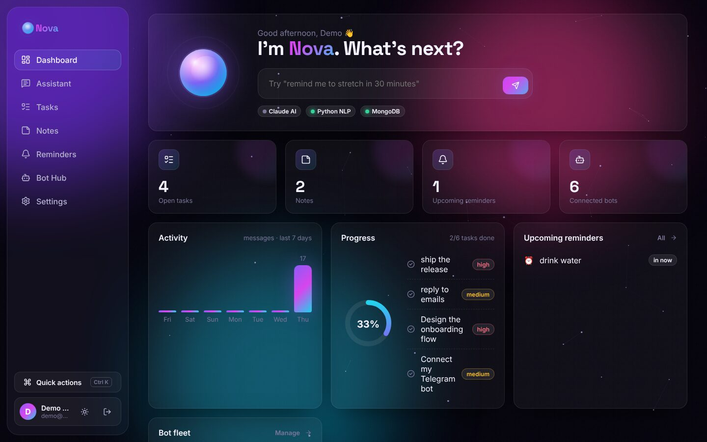
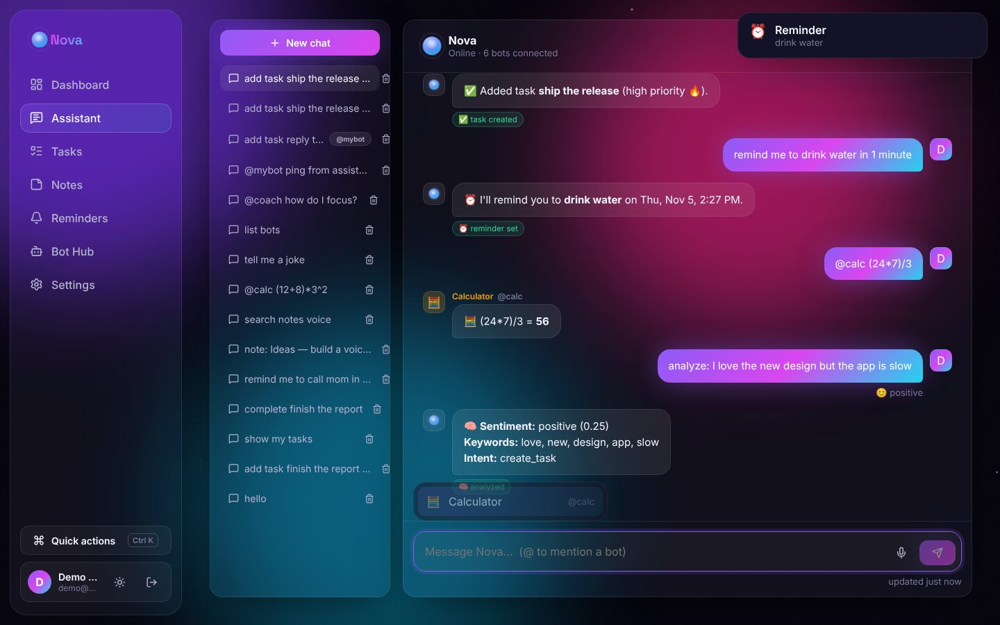
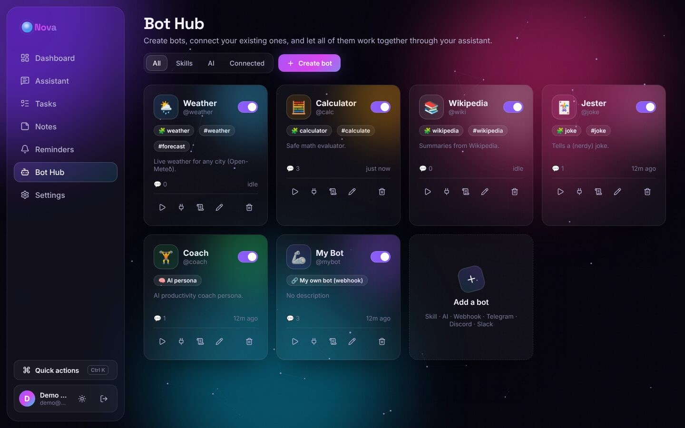
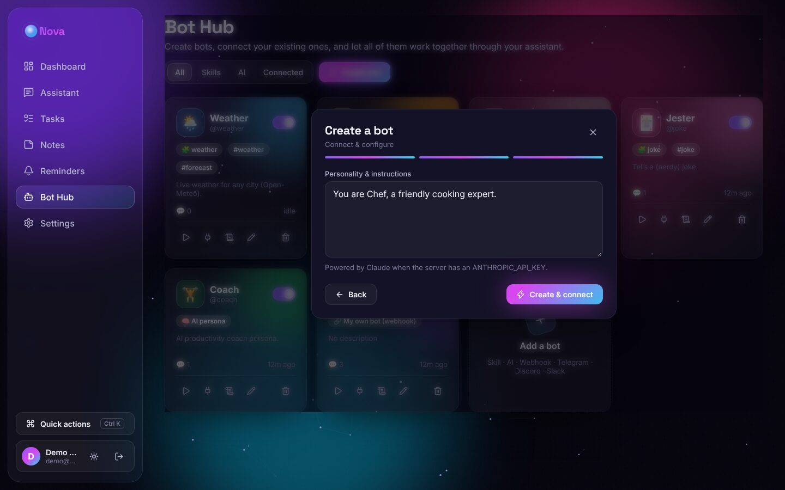
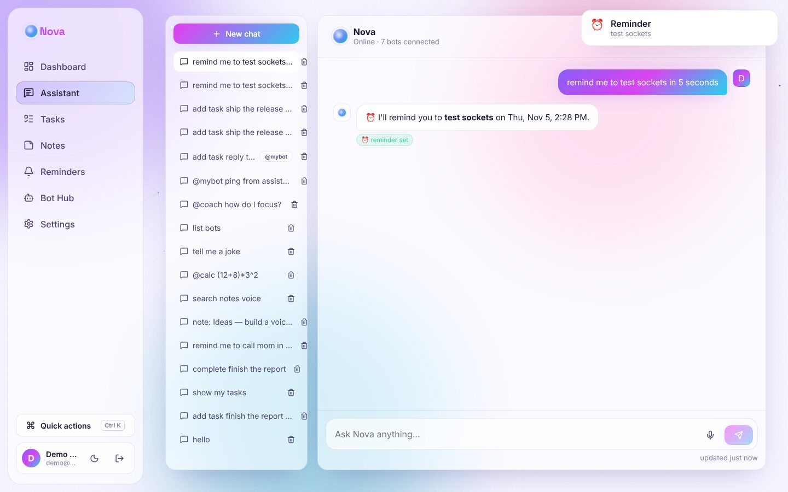
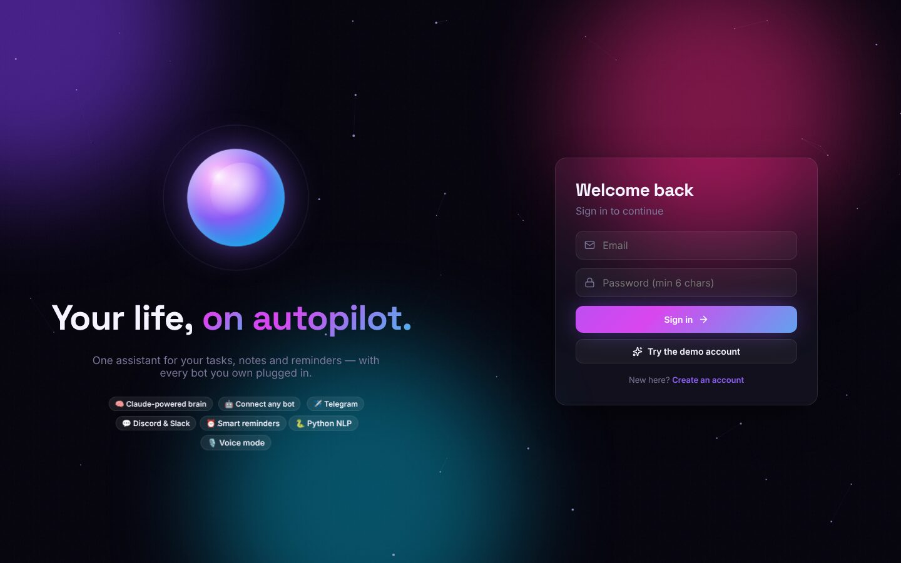
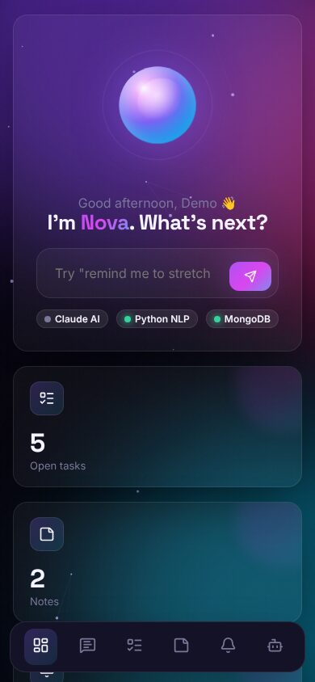

# ✨ Nova — Personal Assistant (end to end)

Nova is a full-stack personal assistant. It manages your **tasks, notes and reminders**, and it acts as a **hub for all your bots**: you can create bots, connect bots you already have (Telegram, Discord, Slack, or any webhook bot you've built), and they all work through one assistant.

| Layer | Tech |
| --- | --- |
| 🎨 Frontend | **React 19** + Vite, **Framer Motion** animations, glassmorphism UI, Lucide icons, Socket.IO client, Web Speech API (voice) |
| ⚙️ Backend | **Node.js** + Express 5, Socket.IO (real-time), JWT auth, node-cron scheduler |
| 🍃 Database | **MongoDB** + Mongoose |
| 🐍 AI service | **Python** + FastAPI: sentiment, intent (Naive Bayes), entities, keywords, summaries |
| 🧠 LLM brain (optional) | **Claude** (`claude-opus-5-5`) with tool use. Without an API key, a built-in rule-based brain is used |



---

## Contents

- [Features](#-features)
- [Screenshots](#-screenshots)
- [Architecture](#-architecture)
- [Quick start](#-quick-start)
- [Using the assistant](#-using-the-assistant)
- [Bots: create and connect](#-bots-create-and-connect)
- [API reference](#-api-reference)
- [Project structure](#-project-structure)
- [Configuration](#-configuration)
- [Testing](#-testing)
- [Deploying](#-deploying)

---

## 🚀 Features

**Assistant**
- Chat in natural language. The assistant takes real actions: creates tasks, saves notes, schedules reminders, and calls bots.
- **Claude brain** (when `ANTHROPIC_API_KEY` is set): an agentic tool-use loop with 10 tools (`create_task`, `set_reminder`, `call_bot`, `analyze_text`, …).
- **Rule-based brain** (no key needed): understands the core commands, so the app works offline.
- **Voice**: speak to it (speech-to-text) and have it read replies aloud (text-to-speech).
- Real-time replies over Socket.IO. Conversations sync across tabs and channels.

**Productivity**
- 📋 Kanban tasks with drag & drop, priorities and due dates
- 📝 Masonry notes with colors and pins. Long notes get an auto-summary from Python
- ⏰ Reminders (once, daily or weekly), delivered as in-app toasts, browser notifications and voice, **and through your Telegram / Discord / Slack bots**
- 📊 Animated dashboard: stats, 7-day activity chart, progress ring, bot fleet, service health

**Bot Hub** (the integration layer)
- **Create** bots with a 3-step animated wizard: built-in skills, AI personas, webhooks, Telegram, Discord, Slack
- **Route** messages to a bot with `@handle` mentions (with autocomplete) or trigger words
- **Connect** any external bot *into* the assistant through the signed **inbound API**
- Test console, activity logs, per-bot stats, enable/disable, API key rotation

**UI / animation**
- Aurora gradient blobs and an interactive particle constellation background
- An animated assistant "orb" with idle, thinking, listening and speaking states
- Shared-layout nav pill, page transitions, staggered cards, spring modals, animated counters and charts
- Command palette (**Ctrl/⌘ + K**): jump anywhere or send a command straight to the assistant
- Dark and light themes, a responsive mobile layout with a bottom nav, and `prefers-reduced-motion` support

---

## 📸 Screenshots

| Assistant chat | Bot Hub |
| --- | --- |
|  |  |
| **Bot creation wizard** | **Light theme + live reminder** |
|  |  |
| **Login** | **Mobile** |
|  |  |

---

## 🏗 Architecture

```
                 ┌───────────────────────────────┐
                 │  React client (Vite, :5173)   │
                 │  Framer Motion · Socket.IO    │
                 └──────────────┬────────────────┘
                     REST /api  │  WebSocket
                 ┌──────────────▼────────────────┐        ┌──────────────────────┐
  Telegram  ───▶ │   Node.js API (Express, :5000)│ ─────▶ │ Python AI (FastAPI,  │
  Inbound API ─▶ │                               │        │ :8000) sentiment,    │
  (your bots)    │  assistant.handleMessage()    │        │ intent, summaries    │
                 │   ├─ @mention / trigger ──▶ botManager ──▶ builtin · AI · webhook
                 │   │                         │           telegram · discord · slack
                 │   └─ brain: Claude tools  or  rule-based
                 │  scheduler (reminders) ─▶ socket + notify bots
                 └──────────────┬────────────────┘
                                │ Mongoose
                        ┌───────▼────────┐
                        │    MongoDB     │  users · conversations · messages
                        └────────────────┘  tasks · notes · reminders · bots · botlogs
```

**One entry point for every channel.** Whether a message comes from the web UI, Socket.IO, Telegram, or another bot through the inbound API, it goes through `server/src/services/assistant.js → handleMessage()`:

1. Save the user message (with sentiment from Python, if the service is running).
2. If the message `@mentions` a bot or contains one of its trigger words, **dispatch it to that bot**.
3. Otherwise the **brain** handles it: Claude with tools, or the rule-based fallback. Tools can call bots too (`call_bot`), so the assistant can orchestrate your whole fleet.
4. Save the reply and push it live to every open tab.

---

## ⚡ Quick start

### Option A: Docker (everything in one command)

```bash
docker compose up --build
# open http://localhost:8080   →  demo login: demo@assistant.dev / demo1234
```

To enable the Claude brain, export `ANTHROPIC_API_KEY=sk-ant-...` before `docker compose up`.

### Option B: Run locally

Requirements: **Node 20+**, **Python 3.10+**, and **MongoDB** (local, Atlas, or `docker run -p 27017:27017 mongo:7`).

```bash
# 1. Install everything
npm install                 # root helper (concurrently)
npm run install:all         # server + client + python deps

# 2. Configure the API
cp server/.env.example server/.env
#    edit MONGO_URI / JWT_SECRET, optionally ANTHROPIC_API_KEY
#    no MongoDB? set USE_MEMORY_DB=true for a throwaway in-memory DB

# 3. Create the demo account (optional)
npm run seed                # demo@assistant.dev / demo1234

# 4. Start API + web + Python service together
npm run dev
```

Open **http://localhost:5173**.

| Service | URL |
| --- | --- |
| Web app | http://localhost:5173 |
| API | http://localhost:5000/api/health |
| Python AI docs (Swagger) | http://localhost:8000/docs |

> The Python service and Claude are both **optional**. The assistant degrades gracefully, and the dashboard shows which services are online.

---

## 💬 Using the assistant

Try these in the chat (they work with the rule-based brain; with Claude, any phrasing works):

| Say | What happens |
| --- | --- |
| `help` | Lists capabilities |
| `add task prepare slides urgent` | Creates a high-priority task |
| `show my tasks` / `complete prepare slides` | Lists / completes tasks |
| `note: wifi — password is blue-42` | Saves a note |
| `search notes wifi` | Searches notes |
| `remind me to call mom in 20 minutes` | Schedules a reminder (`at 5pm`, `tomorrow at 9:30`, `tonight` also work) |
| `@weather in Tokyo` | Live weather bot |
| `@calc (24 * 7) / 3` | Safe calculator bot |
| `@wiki Alan Turing` | Wikipedia bot |
| `tell me a joke` | Routed to the Jester bot by its trigger word |
| `analyze: I love it but it's slow` | Python NLP: sentiment, keywords, intent |
| `list bots` | Shows your bot fleet |

Press **Ctrl/⌘ + K** anywhere to run a command without opening the chat. Click the 🎙️ mic to talk.

---

## 🤖 Bots: create and connect

Every new account starts with 5 bots: **Weather, Calculator, Wikipedia, Jester, Coach**. Open **Bot Hub → Create bot** to add more:

| Type | What it does | You provide |
| --- | --- | --- |
| 🧩 **Built-in skill** | Runs inside the assistant | Pick a skill: calculator, weather, wikipedia, joke, echo |
| 🧠 **AI persona** | A Claude-powered character with its own instructions | A system prompt ("You are Chef…") |
| 🔗 **Webhook (your own bot)** | We POST each message to your server; you reply with JSON | Your endpoint URL |
| ✈️ **Telegram** | Chat with your assistant **from Telegram** and get reminders there | A token from @BotFather |
| 🎮 **Discord** | Post messages and reminders to a channel | An incoming webhook URL |
| 💼 **Slack** | Post messages and reminders to a channel | An incoming webhook URL |

Each bot gets an **API key** and an **inbound endpoint**, so traffic works in both directions:

- **Assistant → your bot**: `@yourbot hello` triggers a signed `POST` to your webhook.
- **Your bot → assistant**: your bot calls `POST /api/integrations/inbound/:botId` with `X-Bot-Key`, and the assistant answers as if you typed it.

```bash
curl -X POST http://localhost:5000/api/integrations/inbound/<BOT_ID> \
  -H "Content-Type: application/json" \
  -H "X-Bot-Key: <BOT_API_KEY>" \
  -d '{"text":"remind me to stretch in 10 minutes","sessionId":"my-bot-chat-1"}'
# → {"reply":"⏰ I'll remind you to stretch on …","conversationId":"…"}
```

📘 Full guide with payload formats, signature verification, and Telegram setup: **[docs/BOT_INTEGRATION.md](docs/BOT_INTEGRATION.md)**.
Ready-to-run examples are in [`examples/`](examples/): a Node webhook bot, a Python webhook bot, and a Python script that talks to the assistant.

---

## 📡 API reference

All routes are prefixed with `/api`. 🔒 means the route needs `Authorization: Bearer <jwt>`.

| Method | Route | Description |
| --- | --- | --- |
| POST | `/auth/register` · `/auth/login` | Returns `{ token, user }` |
| GET/PATCH | `/auth/me` 🔒 | Profile, assistant name, preferences (theme, voice, city) |
| POST | `/chat/message` 🔒 | `{ text, conversationId? }` → `{ conversation, messages:[user, reply] }` |
| GET/DELETE | `/chat/conversations[/:id]` 🔒 | List or delete conversations |
| GET | `/chat/conversations/:id/messages` 🔒 | Message history |
| CRUD | `/tasks` · `/notes` · `/reminders` 🔒 | `GET` · `POST` · `PATCH /:id` · `DELETE /:id` |
| GET | `/dashboard` 🔒 | Stats, activity, upcoming reminders, service health |
| GET | `/bots` · `/bots/meta` 🔒 | List bots, available types and skills |
| POST/PATCH/DELETE | `/bots[/:id]` 🔒 | Create (returns credentials once), update, delete |
| POST | `/bots/:id/test` 🔒 | Send a message directly to a bot |
| GET | `/bots/:id/logs` · `/bots/:id/credentials` 🔒 | Activity log, API key + inbound URL |
| POST | `/bots/:id/rotate-key` 🔒 | Issue a new API key |
| POST | `/integrations/inbound/:botId` | **External bots → assistant** (header `X-Bot-Key`) |
| POST | `/integrations/telegram/:botId` | Telegram webhook (secret-token verified) |

**Socket.IO** (auth: `{ token }`): emit `chat:send` with `{ text, conversationId }` and an ack. Listen for `message:new`, `assistant:status`, `reminder:due`, `data:changed`, `bot:activity`.

**Python AI service:** `GET /health`, `POST /analyze`, `/intent`, `/sentiment`, `/summarize`. Interactive docs are at `:8000/docs`.

---

## 📁 Project structure

```
.
├── client/                    React app
│   └── src/
│       ├── components/        AnimatedBackground, AssistantOrb, Layout, CommandPalette, ui (Modal, Tabs, Switch…)
│       ├── context/           AuthContext (JWT + socket), ToastContext
│       ├── hooks/useVoice.js  Speech recognition + synthesis
│       ├── pages/             Dashboard, Chat, Tasks, Notes, Reminders, Bots, Settings, AuthPage
│       └── index.css          Design system (tokens, glass, dark/light)
├── server/                    Node.js API
│   └── src/
│       ├── models/            User, Conversation, Message, Task, Note, Reminder, Bot, BotLog
│       ├── routes/            auth, chat, bots, integrations, dashboard, crud
│       ├── services/          assistant (orchestrator), llm (Claude), actions (tools), localBrain,
│       │                      scheduler, timeParser, pythonAI, realtime, defaultBots, demoSeed
│       └── bots/              botManager (routing + dispatch), builtins, calculator,
│                              connectors (Telegram/Discord/Slack), telegramBridge
├── ai-service/                Python FastAPI NLP service (+ pytest tests)
├── examples/                  Sample bots to connect (Node + Python)
├── docs/                      BOT_INTEGRATION.md, screenshots
└── docker-compose.yml         mongo + ai-service + server + client
```

---

## 🔧 Configuration

`server/.env` (see `server/.env.example`):

| Variable | Default | Purpose |
| --- | --- | --- |
| `MONGO_URI` | `mongodb://127.0.0.1:27017/personal_assistant` | MongoDB connection |
| `USE_MEMORY_DB` | `false` | `true` boots an in-memory MongoDB and seeds the demo user |
| `SEED_DEMO` | — | `true` creates the demo account on startup |
| `JWT_SECRET` | dev value | **Must** be set in production |
| `ANTHROPIC_API_KEY` | — | Enables the Claude brain and AI persona bots |
| `CLAUDE_MODEL` | `claude-opus-5-5` | Claude model id |
| `AI_SERVICE_URL` | `http://localhost:8000` | Python service |
| `CLIENT_URL` | `http://localhost:5173` | CORS origin |
| `PUBLIC_API_URL` | `http://localhost:5000` | Public URL of the API. If it's `https://…`, Telegram uses webhooks; otherwise the server long-polls Telegram, which works on localhost |

`client/.env`: `VITE_API_URL` (leave it empty in development; Vite proxies `/api`).

---

## 🧪 Testing

```bash
npm test                       # server unit tests + python tests
npm --prefix server test       # calculator, time parser, intents, signatures
cd ai-service && python -m pytest -q
```

---

## ☁️ Deploying

- **Database:** MongoDB Atlas (set `MONGO_URI`).
- **API:** any Node host (Render, Railway, Fly.io, a VPS). Set `JWT_SECRET`, `CLIENT_URL` and `PUBLIC_API_URL=https://your-api` (this enables Telegram webhooks).
- **Python service:** any container host. Set `AI_SERVICE_URL` on the API.
- **Client:** `npm run build` and serve `client/dist` (Netlify, Vercel, nginx). Set `VITE_API_URL=https://your-api` at build time, or use the provided nginx proxy config.

### Security notes
- Passwords are hashed with bcrypt. Sessions use JWT (7 days).
- Bot secrets (API keys, Telegram tokens) are never sent to the browser after creation. They're shown only on the Connect panel, and tokens are masked.
- Outgoing webhooks are signed: `X-PA-Signature: sha256=HMAC(apiKey, body)`.
- Inbound calls are checked with a timing-safe key comparison and rate-limited.
- A Telegram assistant links to the **first chat** that messages it. Every other chat is refused.

---

Built with React, Node.js, MongoDB and Python. Have fun automating your life ✨
